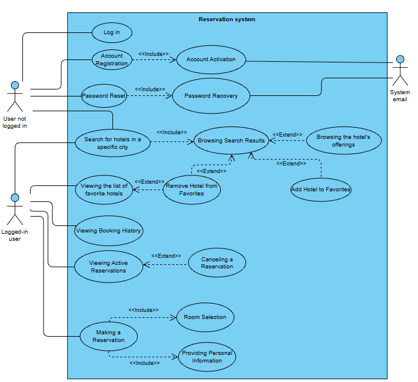
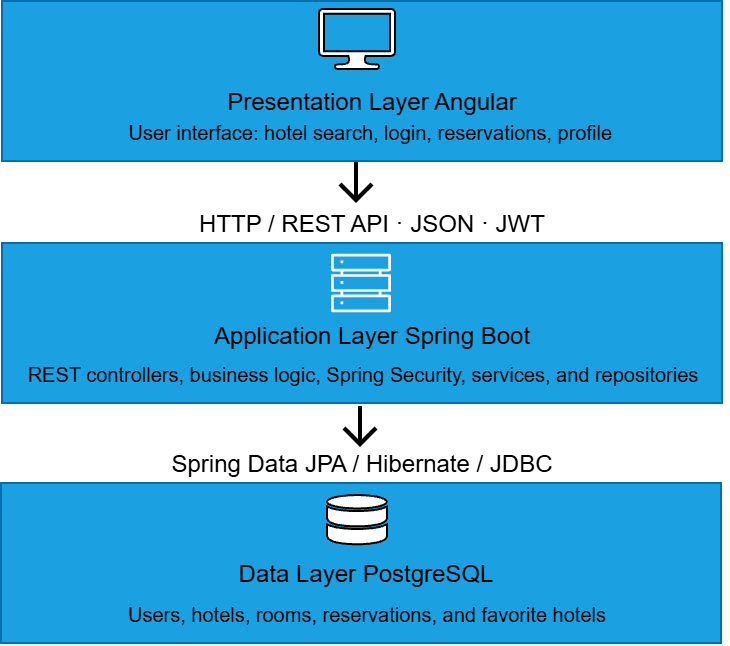

# HotelApp Backend

**A REST API for a hotel reservation system built with Java and Spring Boot.**

HotelApp Backend is a server-side application responsible for 
handling the business logic and data management of a hotel reservation system.
It provides REST API endpoints for user authentication, hotel and room management, 
reservation processing, and favorite hotels. 
The application uses Spring Security with JWT for authentication and 
authorization, while PostgreSQL is used for persistent data storage.

## Features

### Authentication and Account Management
- User registration and login.
- JWT-based authentication and authorization.
- Email account activation.
- Password recovery and reset functionality.
- Secure password storage using BCrypt.

### Hotel Search and Room Selection
- Search for hotels by city.
- Search based on check-in date, check-out date, and number of guests.
- Browse hotel details and available rooms.
- View room prices and maximum guest capacity.
- Sort search results by price.

### Reservation Management
- Create hotel room reservations.
- Validate room availability for the selected dates.
- Prevent conflicting reservations.
- View active reservations.
- View booking history.
- Cancel reservations according to the application's cancellation rules.

### Favorite Hotels
- Add hotels to a favorites list.
- Remove hotels from favorites.
- View saved favorites.

### Email Integration
- Send account activation emails.
- Send password recovery emails through an SMTP server.

## Tech Stack

| Technology | Purpose |
|---|---|
| Java 21 | Programming language |
| Spring Boot 3.5 | Backend framework |
| Spring Web | REST API development |
| Spring Security | Authentication and authorization |
| JWT | Token-based authentication |
| BCrypt | Password hashing |
| Spring Data JPA | Data access layer |
| Hibernate | Object-relational mapping |
| PostgreSQL | Relational database |
| Maven | Dependency management and build automation |
| Spring Mail | Email delivery |

| Angular | Frontend application |

## System Architecture

The application follows a three-layer client-server architecture. The Angular frontend communicates with the Spring Boot backend through REST API endpoints. The backend processes requests, applies business rules, and interacts with the PostgreSQL database.



### Use Case Diagram

The use case diagram presents the main system functionalities and the interactions between users and the Hotel Reservation System.

It includes user authentication, account activation, password recovery, hotel search, room selection, reservations, favorite hotels, and booking management.



## Database

The application uses PostgreSQL to store user accounts, hotel information, rooms, reservations, and related data.

The main database tables include:

| Table | Description |
|---|---|
| `users` | User accounts, credentials, personal information, and account activation data |
| `hotels` | Hotel information and location details |
| `rooms` | Room details, capacity, and pricing |
| `reservations` | Reservation dates, status, user, room, and total price |
| `favorite_hotel` | Favorite hotels associated with users |
| `reset_password_token` | Password recovery tokens |

JPA entities and Hibernate handle object-relational mapping between Java objects and database tables.

## Getting Started

### Prerequisites

Before running the application, make sure you have installed:

- Java JDK 21
- Maven 3.9 or later
- PostgreSQL 17 or a compatible version

### 1. Clone the repository

```bash
git clone https://github.com/MateuszWrz/HotelAppBackend.git
cd HotelAppBackend
```

### 2. Configure the database

Create a PostgreSQL database for the application:

```sql
CREATE DATABASE hoteldb;
```

Configure the database connection using the environment variables expected by the application:

```text
DB_URL=jdbc:postgresql://localhost:5432/hoteldb
DB_USERNAME=your_database_username
DB_PASSWORD=your_database_password
```

Make sure the variable names match the application's configuration.

### 3. Configure email settings

The application requires SMTP credentials to send account activation and password recovery emails.

```text
MAIL_USERNAME=your_email_address
MAIL_PASSWORD=your_email_app_password
```

Use the appropriate SMTP settings for your email provider. Never commit real credentials or secrets to the repository.

### 4. Run the application

Start the backend using Maven:

```bash
mvn spring-boot:run
```

If the Maven Wrapper is available, you can use:

**Windows:**

```bash
mvnw.cmd spring-boot:run
```

**Linux / macOS:**

```bash
./mvnw spring-boot:run
```

The backend is configured to use port `8081` by default, unless overridden by the `PORT` environment variable.

```text
http://localhost:8081
```

**Note:** A correctly configured PostgreSQL database and all required environment variables must be available before the application can start successfully.

## Security

The application implements several security mechanisms:

- JWT-based authentication for protected API endpoints.
- Spring Security for access control.
- BCrypt password hashing.
- Email-based account activation.
- Password recovery through a dedicated reset process.
- Environment variables for sensitive configuration.
- Reservation availability checks to prevent conflicting bookings.

## Future Improvements

Potential future enhancements include:

- Automated unit and integration tests.
- API documentation with OpenAPI / Swagger.
- Hotel reviews and ratings.
- Online payment integration.
- Hotel image galleries.
- Additional logging and monitoring.

